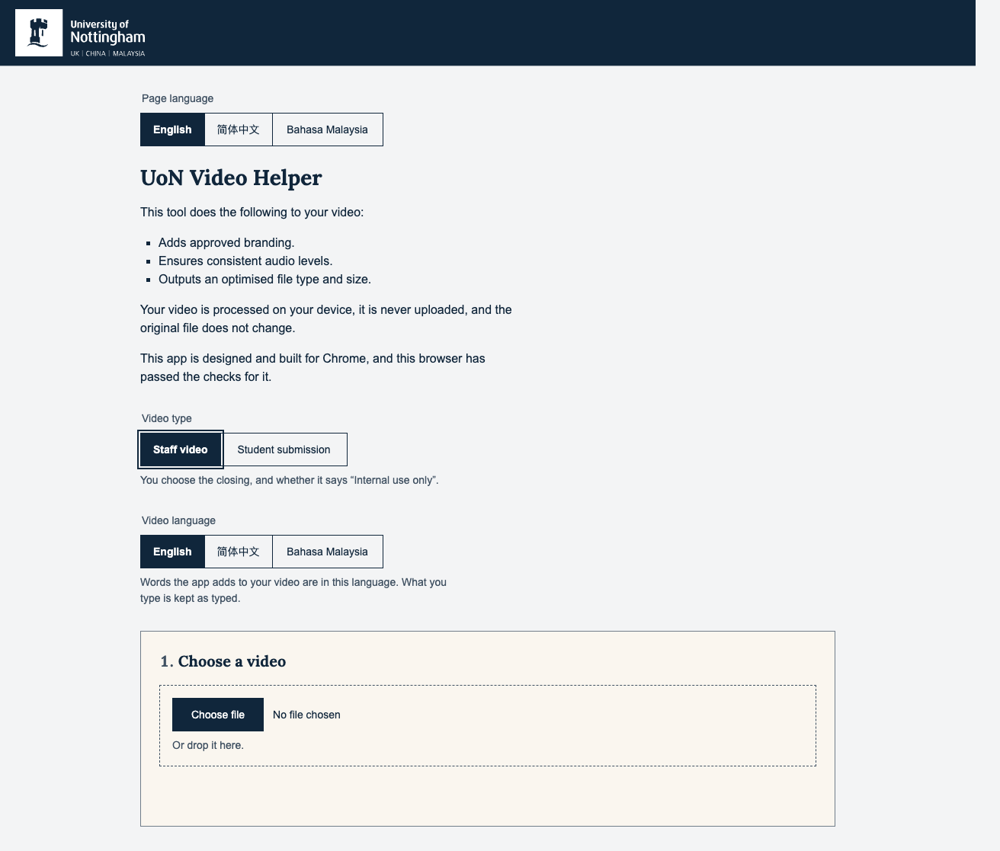
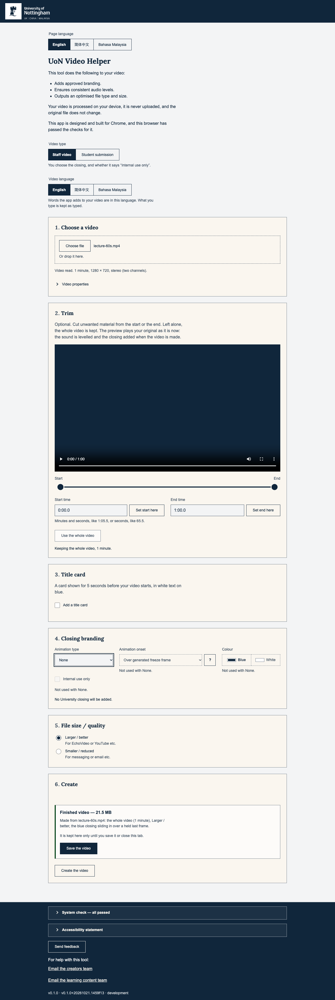
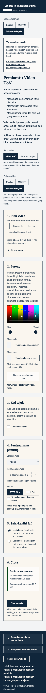

# Design pass — 21 October 2026

The 20 October audit (VH-138) measured the live page for accessibility and
usability. This pass judges it as a design, against the standard VH-124 set
on 1 October 2026: formatting, UI and visual design. Backlog item VH-143,
the first step of the owner's overnight run of 21 October. Self-contained,
as the audit is. Its findings run on from the audit's, V-18 to V-30, and
the audit's Disposition table and the bundle's README carry them, so every
finding reads as one list.

## Verdict

The page still reads as one design. Its type is one ramp (28, 20, 16 and
14 px), its panels one rhythm (24 px), its notifications one anatomy, and
every new surface reuses a component that was already there. One filled
action leads each state that has one, and nothing fails the measured
contrast, overflow or text-spacing checks in 285 views. The cards the app draws hold the owner's
28 pt floor at every shape in every language.

What has slipped is at the edges of the system, not its centre:

- **The frame above step 1.** Page language now sits above the title,
  and Video type and Video language between the lede and step 1. On a
  900 px desktop window "Choose file" has dropped just below the first
  screen (V-18). The page's structure is the
  owner's, so this is put as a question with a recommendation.
- **The browser's own styling.** Where `app.css` is silent the browser
  still decides: a 14 px gap under every status line, a 2 px inset on the
  switchers' legends, the radios' margins, the select's line height, the
  monospace face; and no token names a weight (V-19).
- **Lines said twice.** Under None one reason shows three times (V-20), and
  after a download the lifetime twice (V-21).
- **One target too small.** In Malay at 320 px the trim's time fields
  shrink to 26 px wide (V-23), which the 20 October walk recorded and the
  audit missed.
- **Form in the tables.** Each table mixes its own marks (V-27), names one
  thing two ways (V-28), and writes two of the ID rules as fixed numbers
  (V-29).

13 findings: 7 at rank 2 and 6 at rank 3, none at rank 1. Phase 3's items
take five (V-21, V-22, V-27, V-28 in part, V-29). A new Phase 4 of three
items takes five (V-19, V-20, V-23, V-25, V-30). Three go to the owner,
each with a recommendation: V-18, the frame above step 1; V-24, the
statement's lists, which VH-137 owns; and V-26, a reading for the VH-124
walk-through.

## How it was done

The walker of 20 October, rebuilt in the second overnight session:

- **A computed-style sweep on every capture.** `window.__audit.styles()`
  wrote `*-styles.json` beside each capture.
- **A `cards` scenario over `spike-cards.html`.** It drew both title cards
  and the closing's words at 16:9, 16:10, 4:3 and 9:16 in three languages
  with the real renderer: 37 frames.
- **Four scripts beside the walker:**
  - `tokens.mjs` lists every computed length, type and colour whose value
    is not one the two token files define. It checks the number, not where
    it came from, so a 14 px margin passes because 14 px is a type size.
    Each value below was traced to its rule by hand.
  - `words.mjs` counts words per state against VH-124's 29 after-states.
  - `strings-sweep.mjs` checks the three tables for form.
  - `sidebyside.sh` puts 1 October beside today.

How the walk ran:

- **Browser and server.** Headless Chrome 155 on port 9222, against this
  worktree's Vite server on port 5174. ffmpeg fixtures only.
- **Views.** 1280 × 900; 390 × 844 with mobile emulation; 320 px; text
  spacing; light, dark and forced colours.
- **Coverage.** English, Simplified Chinese and Bahasa Malaysia, on both
  sides of the switch, with a card off and on, and with every closing:
  thirteen scenarios, with no failure. Three captures are named for a
  state the page had already left: `15-title-card-refused` (it shows
  Analysing audio) and Malay's `card-refused` and `running` variants (a
  finished result). No finding rests on them.
- **Codex astra's blind review.** It ran (`codex exec -m gpt-6-astra -s
  read-only`) from the brief kept beside it. Its five findings were each
  verified in source, and D-01 and D-02 live. Then it critiqued the merged
  draft. Both are kept as written.
- **Four readers.** Four Claude subagents read the measurements, the cards,
  the captures and the source, briefed from the same standard. Every
  finding below was checked against a capture or a source line before it
  was kept.

The walk had two interruptions. The Mac slept from about 01:53 to 08:30
BST and stopped every Terminal tab. The walk was restarted from its first
scenario, so every capture here is from one run, finished at 08:44 BST.

Measurements, in `evidence/measurements/`:

- `token-sweep-2026-10-21.md`;
- `word-counts-2026-10-21.md`;
- `strings-sweep-2026-10-21.md`;
- one digest per walk, `<scenario>-2026-10-21.txt` (the undated ones are
  the 20 October audit's).

Screenshots are in `evidence/`, named by finding (`v18-…` to `v30-…`), by
what was set aside (`aside-…`), by what held up (`held-…`), and
`before-after-…` for 1 October beside today.

Codex astra's five, by number:

| Codex | Finding |
| --- | --- |
| D-01 | V-19 |
| D-02 | V-20 and V-21 |
| D-03 | V-24 |
| D-04 | V-22 |
| D-05 | V-27 |

## Findings

### V-18 Above step 1, three switchers push the first action down the first screen — rank 2

**Saw.** The empty page is 1,531 px tall at desktop (951 on 1 October). Its
first action has moved down:

- **Then.** On 1 October "Choose file" sat about 550 px down.
- **Now.** Page language sits above the title (73 px and a 24 px gap).
  Between the lede and step 1 sit Video type (102 px and 32) and Video
  language (123 px and 32). "Choose file" sits just below a 900 px window,
  read from the capture at about 916 px; on a 390 × 844 phone step 1's
  heading starts at about 913 px.
- **Weight.** Above it are three selected segments in the same Nottingham
  Blue fill and 44 px height as the filled button. On the empty page that
  is four blue fills; on the ready page five: three switchers, Blue and
  Create.
- **Words.** The switchers and their lines are about 47 words before step 1.

**Standard.** VH-124: one clear next action, and nothing competing with it.
Spec §13: the GUI review judges distraction. UI-STANDARDS → Minimalist
design.

**Direction.** The page's structure, including the three switchers above
step 1, is the owner's and is not decided here. The recommendation, as a
wish line:

- Move Page language into the header band, on the right, where the
  University's own site carries its utility links. It is about the page,
  not the video. At desktop that gives back about 97 px, if the band does
  not grow. A phone needs its own layout for the band before any saving
  can be promised there.
- Leave Video type and Video language where they are, under the lede,
  because they shape the steps.
- Keep the selected segment's fill: it marks a choice, not an action, and
  VH-124 accepted it for the closing's colour.

**Source.** `index.html:43`–`92`; `src/main.ts:3391` (Page language
inserted above the title); `src/ui/language-switcher.ts:64`;
`src/styles/app.css:147`, `:1120`–`1127`. **From:** walkthrough, measured.
**Evidence:** `v18-page-top.png`, `before-after-01-empty.png`,
`before-after-08-ready.png`; `desktop-en-staff-2026-10-21.txt` (page
sizes).

### V-19 The token system stops where the browser's styling begins — rank 2

**Saw.** Where `app.css` says nothing, the browser decides, and the computed
styles show it:

- **Status lines.** Every status line (`.status`: step 1's, step 6's, the
  save's, the feedback dialog's) sets its top margin and leaves the
  paragraph's bottom margin of 1em, 14 px at its compact size. 14 is not
  on the spacing scale. It is one part of a band of about 90 px between
  "6. Create" and its notification: the heading's 16 px, the line's
  reserved 24 px and its 12 px top margin, the notification's 24 px, and
  this 14 px. The reservation is deliberate (VH-111, so a status arriving
  moves nothing); the 14 px is not. `min-height` also reserves a body-size
  line for compact text.
- **Legends.** The three switchers' legends keep the browser's 2 px inline
  padding (`.choice .label` resets it; `.segmented` does not), so their
  labels sit 2 px right of the title and of every other label.
- **Radios.** `.radio input` keeps the browser's 5 px and 3 px margins,
  where `.checkbox input` sets `margin: 0`.
- **The select.** `.select` sets `font: inherit` but not its line height,
  so its visible text takes the browser's `normal` for the native control.
- **Weights.** Weights are literals and no token names them: 600 on six
  rules (notification titles, item titles, the footer's summaries, the help
  button, the selected segment and its reserve) and 700 on four (the page
  title, a step's heading, a check's mark, the statement's subheadings).
- **Monospace.** `<pre>` (a captured error's stack, the feedback details)
  takes the browser's monospace face; no token names one.
- **The dialog's gutter.** On a phone, the browser's own
  `max-width: calc(100% - 38px)` beats the dialog's rule, so its gutter is
  19 px, not the 16 px intended.
- **Smaller ones.** `.choice` keeps the fieldset's `min-content` width;
  `#errors-intro` has no class and keeps 1em margins.

`test/stylesheet.test.ts` checks the declarations that exist. It cannot see
a value the browser supplies because a declaration is absent. The empty
save line's own reset (`app.css:276`) stays.

**Standard.** VH-124: layout, spacing and type come only from the two token
files on the Carbon scale. UI-STANDARDS → Perceivable ("every length …
is a token"). The Carbon digest: the spacing scale; tokens, not literals.

**Direction.** Set these explicitly with the tokens that exist:

- `margin: var(--spacing-05) 0 0` on `.status`, with a compact line in its
  `min-height`;
- `padding: 0` on the segmented legends;
- `margin: 0` on the radios, keeping the described radio's own alignment;
- a line height from the tokens on `.select`, or the native one recorded;
- `min-width: 0` on `.choice`;
- the dialog's `max-width` stated;
- the errors intro given the step intro's class.

Name the weights as type roles in `tokens.carbon.css`: regular 400,
semibold 600 (Carbon's compact headings) and bold 700 (the brand's
headings). Use them in place of the literals, and extend the stylesheet
test to `font-weight` and to the defaults named here. Name a monospace stack beside the brand's faces, or
record the diagnostics' face as an exception.

**Source.** `src/styles/app.css:270`, `:399`–`404`, `:444`, `:464`, `:469`,
`:769`–`777`, `:788`–`792`, `:877`, `:1015`, `:1039`, `:1086`, `:1170`,
`:1428`–`1440`, `:1475`; `:163`, `:245`, `:305`, `:905`; `index.html:603`;
`test/stylesheet.test.ts:71`. **From:** Codex astra D-01; the token sweep;
the captures. **Evidence:** `token-sweep-2026-10-21.md`; `p#status`
`marginBottom: 14px` in every `*-styles.json`;
`before-after-18-finished.png`.

### V-20 Under None, one reason is said three times — rank 2

**Saw.** With Animation type at None, step 4 shows "Not used with None."
three times, under Animation onset, Colour and Internal use only. Each
helper returns the same sentence. The line beneath, "No University closing
will be added.", is a different thing, the output's consequence, and stays.

**Standard.** VH-124: no visible line repeats another in view.
UI-STANDARDS → Minimalist design. Nielsen 8.

**Direction.** Under None, one line under the three locked controls says
why, and each control keeps it in its `aria-describedby`. Under Cut, onset's
own reason stands as it is.

**Source.** `src/ui/closing-choice.ts:67`–`80`; `src/i18n/en-GB.ts:312`;
`src/main.ts:555`. **From:** Codex astra D-02; verified in
`closings/none-step4.txt` (three lines). **Evidence:**
`v20-none-three-reasons.png`.

### V-21 After a download, the result's lifetime is said twice — rank 2

**Saw.** On a phone, after the download is handed to the browser, the
result says "It stays here until you start another video or close this
tab." Four lines below, the save line ends "The video stays here until you
start another one." Both are painted by the download branch.

**Standard.** VH-124: no visible line repeats another in view; a status
line says only what no panel shows (UI-STANDARDS → Perceivable).

**Direction.** The result keeps its lifetime sentence. The save line drops
its last sentence and keeps where the file went, that the browser may
still be finishing it, and what next. These are V-04's lines, so it joins
VH-141.

**Source.** `src/main.ts:3104`–`3111`; `src/i18n/en-GB.ts:407`
(`result.lifetimeDelivered`), `:868` (`save.download`). **From:** Codex astra
D-02; verified in `phone-en-staff/09-download-handed-off.txt` (lines 93 and
97). **Evidence:** `v21-download-lifetime-twice.png`.

### V-22 A failed save is a grey status line under a success notification — rank 2

**Saw.** When a save fails, the page writes "The video could not be saved.
It is still here to try again." to the save line. That line is compact
secondary text, the same as "Saving…" and "Saved.". It sits under the
result's success notification. A job's failure, a blocked file and an
unreadable one are each an error notification with a title and a next
step; this one, the save's own failure, is not. Refusing to overwrite the
original also uses the save line, but that is a refusal before anything
is written, not a failure.

**Standard.** UI-STANDARDS → one inline notification for everything worth
knowing; Nielsen 9; the Design review gate, point 9.

**Direction.** A failed save shows an error notification beside the kept
result, with the two sentences it has now as title and body, announced
once and cleared by a retry or any later outcome, so it never stands
beside a successful save. Saving, stopping and saved stay on the save
line, and the retry stays where it is. Verifying it needs a save made to
fail on purpose.
The lines are V-12's (the save's completion and its failure), so it joins
VH-141.

**Source.** `src/main.ts:3154`; `src/i18n/en-GB.ts:386`; `index.html:587`;
`src/styles/app.css:399`. **From:** Codex astra D-04; source only, since no
fixture fails a save.

### V-23 In Malay at 320 px, the trim's time fields shrink to 26 px — rank 2

**Saw.** Step 2's time fields sit in a row with their "Set … here" button.
The button does not shrink and the field does. Malay's buttons are long
("Tetapkan permulaan di sini"), so at 320 px "Masa mula" and "Masa tamat"
are 26 × 44 px; at the 640 px stand-in for 200% the start field is 34 px.
A 26 px field has no room left for text: its padding takes 24 px and its
borders 2. It holds in every Malay state with step 2 in view, on both sides
of the switch, and while locked. English and Chinese fit.

The 20 October walk recorded the same widths (`desktop-ms-staff.txt`, line
29); the audit did not report them.

**Standard.** WCAG 2.5.5 (AAA, the profile's 44 px targets); UI-STANDARDS
→ Operable; a field must show what is typed in it.

**Direction.** Let step 2's two time rows wrap when the field would fall
under its minimum: the field keeps `--field-min-width` and the button goes
under it. Scope it to the trim rows; `.control-with-help` also holds the
onset select and its help button, which fit. No new token.

**Source.** `src/styles/app.css:1000`, `:1370`, `:1396`–`1402`;
`src/i18n/ms-MY.ts:168`–`169`.
**From:** the token sweep's target rows. **Evidence:**
`v23-ms-trim-fields-320.png`; `desktop-ms-staff-2026-10-21.txt` lines 31
and 45 (enabled), 96 (locked); `desktop-ms-submission-2026-10-21.txt`.

### V-24 The statement's two lists break the capital-and-stop rule — rank 2

**Saw.** The accessibility statement has two lists whose items start
lower-case and end without a stop, in English and Malay. In Chinese they
end without 。:

- **What you should be able to do:** five items, such as "use it with a
  keyboard alone".
- **The next tests:** six items, such as "using the tool with a keyboard
  alone".

Its list of limitations, in the same panel, is in full stopped sentences.
Two abilities and one limitation also keep straight apostrophes
("computer's"). The tests pin the count of items, not their form.

**Standard.** VH-124: every list item and sentence starts with a capital
and ends with a full stop. The statement follows the GOV.UK model, whose
own house style writes such lists in lower case without stops.

**Direction.** The statement's words are VH-137's, the owner's review, so
this is a wish line, not a change tonight. The recommendation: give the
eleven items a capital where the language has one and the language's own
stop, in that review, as the limitations list already has, and curly
apostrophes. Following the GOV.UK model's structure does not by itself
make an exception to VH-124's rule. The footer's two contact links are a
list too, unstopped; how VH-124's rule reads on a list of links is put to
the owner's walk-through, with V-26.

**Source.** `src/i18n/en-GB.ts:781`, `:828` (`statement.abilities.*`,
`statement.plans.items.*`); `src/i18n/zh-Hans.ts:701`, `:742`;
`src/i18n/ms-MY.ts:756`, `:800`; `test/screen-text.test.ts:271`. **From:**
Codex astra D-03; the string sweep. **Evidence:** `v09-statement-open.png`.

### V-25 One job, several classes — rank 3

**Saw.** The new surfaces reuse the right components, and they draw
consistently. The stylesheet behind them has grown near-twins:

- **Links on a line of their own.** `.footer-contact-link` and
  `.notification-link` are the same three declarations. `.result-link`
  draws the same job a third way, and nothing uses it.
- **Secondary lines.**
  - `.lock-note` is `.helper` with its margin moved, and `.fact-note` is
    `.helper` with a smaller gap.
  - The intro under a heading is grey in a step (`.step-intro`) and in the
    primary colour in the dialog (`.dialog-intro`). The errors panel's has
    no class.
  - In a locked step 2, the lock note and the intro stack: two grey lines
    at two sizes.
- **Result lines.** `.closing-result` and `.trim-result` are one rule twice.
- **Content-sized segments.** They are written out for three containers by
  name across seven selector groups. Their re-added left edge outranks
  `.segmented:disabled`, so if one were ever locked, its later segments
  would keep a solid edge. Today none is ever locked.

**Standard.** UI-STANDARDS → Consistency (the same patterns for the same
concepts); the Carbon digest (reuse an existing pattern before creating a
new one). No rule asks one class name per job, and the lock note and the
intro say different things, so most of this is maintenance, not a design
defect.

**Direction.** Only the part that costs nothing, since VH-145 edits these
rules anyway: delete the unused `.result-link`, and group the two identical
link rules and the two identical result-line rules under one selector each.
No class is renamed in the markup. The notes, the intros and the
content-sized segments stay as they are; their locked edge is hypothetical
while they are never locked.

**Source.** `src/styles/app.css:198`–`202`, `:590`–`594`, `:647`–`652`,
`:759`–`765`, `:1102`, `:1129`–`1173`, `:1182`–`1193`, `:1219`–`1229`,
`:1404`–`1407`, `:1447`–`1449`; `index.html:603`; `src/main.ts:386`.
**From:** the source audit of one component for one job.

### V-26 In the footer, a panel's heading is smaller than its own subheadings — rank 3, for the owner

**Saw.** "Accessibility statement" and "System check" are level-two
headings inside their summaries, drawn at 14 px and 600 (the summary's
compact size, `font: inherit`). The statement's level-three subheadings
inside them are 16 px and 700, and a notification's title is 16 px and 600.
The ramp inverts.

**Standard.** VH-124: type from one scale; Carbon's productive type styles
(a heading over its subheadings).

**Direction.** The stylesheet records the choice: the summary's heading is
"a heading for navigation, not for size" (`app.css:885`), a disclosure bar
over prose, and a heading's level does not by itself ask a larger size.
Whether the ramp should hold across that is a reading for the owner's
walk-through of VH-124, as a wish line. If it should, the two summaries
take `--type-heading-compact` (16 px) and the statement's subheadings the
semibold weight, so the two meet.

**Source.** `src/styles/app.css:829`–`836`, `:873`–`890`, `:902`–`907`.
**From:** the captures. **Evidence:** `v26-footer-heading-ramp.png`.

### V-27 Each table mixes its own marks — rank 3

**Saw.** Form only; the meaning is the native speakers'.

- **English and Malay.** Four feedback leaves quote "Copy message and
  details" and "What will be sent with it" in straight marks: `tooLong`,
  `opened`, `couldNotCopy` and `onlyInCopy`. Every other quotation is
  curly, and the Chinese of the same four is curly too. English
  apostrophes are straight in `feedback.whatSentDetail` and curly in seven
  leaves.
- **Chinese ellipses.** Ongoing states end in 「……」
  (`status.checking`, `status.stoppingSave`, `*.reading`) and 「…」
  (`status.cancelling`, `status.saving`).
- **Chinese terminal stops.** Three leaves end in 。 where the Chinese
  leaves beside them do not: a button label (`create.discard`, beside
  留着它 and 保存视频), a notification title (`discard.title`; the other
  Chinese titles have none) and a table value
  (`systemCheck.values.aacNotSupported`, beside 不支持). The comparison is
  within the Chinese table; spec §9 gives each language its own
  punctuation.
- **Chinese spacing.** `preflight.chromeLacks` writes 此Chrome浏览器
  where every other leaf writes "Chrome 浏览器". Placeholders are spaced
  both ways, but they hold different things (an address, a number, an
  option's name), and `preflight.sizeUpTo`'s 可达{size} is unspaced by the
  VH-122 decision. That is left to the colleague.
- **Chinese brackets.** `save.pickerDescription` has ASCII brackets; every
  other leaf has full-width ones.
- **Malay.** `preset.details.smaller` writes "emel" where seven leaves
  write "e-mel".

**Standard.** UI-STANDARDS → Consistency; spec §9: each language has its
own sentence punctuation. The VH-122 decision: Chinese sets no space
before a number filled in, but a placeholder keeps its spaces where its
siblings have them.

**Direction.** Through the strings sheet and `scripts/strings-table.mjs`:

- curly marks in the four English and four Malay leaves and in
  `feedback.whatSentDetail`;
- one Chinese ellipsis, 「……」, the majority;
- the three Chinese stops dropped, as their Chinese siblings have none;
- "Chrome 浏览器";
- full-width brackets;
- "e-mel".

The statement's straight apostrophes are VH-137's (V-24).

These are VH-142's lines (the words), so it joins that item. Left to the
colleagues:

- **Malay:** "penutup" and "penutupan" for the closing, and "Hentikan"
  beside "Berhenti".
- **Chinese:** whether the VH-122 rule covers digits written in the
  table, as in 5.1环绕声 against 步骤 2, and how a placeholder is spaced
  by what it holds (发送至{address} against 发送到 {address}; 共有{count}个
  against 这里有 {count} 个).

**Source.** `src/i18n/en-GB.ts:104`, `:757`–`765`; `src/i18n/zh-Hans.ts:76`,
`:160`, `:325`–`330`; `src/i18n/ms-MY.ts:36`, `:325`, `:742`–`749`.
**From:** Codex astra D-05; the string sweep and its reading.
**Evidence:** `strings-sweep-2026-10-21.md`.

### V-28 One thing, two names — rank 3

**Saw.**

- **The job.** It is "Create" in the step, the button and the status
  line, but "build" in three failure leaves:
  `preflight.reasons.noOpfsHere`, `noOpfsElsewhere` ("to build your
  video") and `failure.startup.noWorkingStore`.
- **The tool.** It is "the tool" in fourteen leaves and "the app" in four.
  `browserNote.*` ("This app is designed and built for Chrome") sits two
  lines under the lede's "This tool"; the others are
  `videoLanguage.helper` and `feedback.whatSentDetail`.
- **The levelling.** It is "sound" in 33 leaves and "audio" in the lede's
  second promise and the page's description.

**Standard.** UI-STANDARDS → Consistency ("Do not create synonyms for
existing concepts"); Nielsen 4.

**Direction.** In VH-142, through the sheet: "create" for the job in the
three failure leaves, and "the tool" in `videoLanguage.helper` and
`feedback.whatSentDetail`.

The lede's three promises and the browser sentence are the maintainer's
own words (`test/screen-text.test.ts:67`–`95`), so they are a wish line.
The recommendation: the browser sentence says "This tool"; "consistent
audio levels" stays, as an everyday phrase the owner chose.

**Source.** `src/i18n/en-GB.ts` at the keys named. **From:** the string
sweep's word families, read leaf by leaf.

### V-29 Two of Submission's rules are written into the words, not taken from config — rank 3

**Saw.** `titleCard.submission.idsHelper` ("Each student ID … is 8 digits.
Type one to eight …") and `idNotAnId` ("Each is 8 digits.") write the ID's
length and the most IDs as fixed text, in all three tables. The same rules
live in `src/config/cards.ts` as `STUDENT_ID_PATTERN` and
`STUDENT_IDS_MAX`, and their sibling `idsTooMany` already takes `{max}`.

**Standard.** `project/rules.md` → Always: numbers live in `src/config/`; a
literal elsewhere is a defect. UI-STANDARDS → Consistency.

**Direction.** Define the ID's length once in `src/config/cards.ts`,
derive `STUDENT_ID_PATTERN` from it, and fill both leaves from it and from
`STUDENT_IDS_MAX`, as `idsTooMany` does, so the check and the words cannot
part. VH-140 rewrites Step 3's rules for Submission (V-06), so it joins
VH-140.

**Source.** `src/i18n/en-GB.ts` (`titleCard.submission.idsHelper`,
`idNotAnId`, `idsTooMany`); `src/config/cards.ts` (`STUDENT_ID_PATTERN`,
`STUDENT_IDS_MAX`). **From:** the string sweep's literal numbers.

### V-30 A Submission card can break its date or its note mid-phrase — rank 3

**Saw.** Every one of the 37 frames passed: no size under 56, no field
over its lines, nothing clipped, every card inside its safe area. At the
worst case, every field at its limit, three things fall short of the type:

- **4:3, Chinese.** The card date's note breaks as "（非 / 提交日期）",
  leaving "not" at a line's end and "submission date" at the next line's
  start. That note exists to stop exactly that misreading.
- **9:16, Chinese.** The date itself breaks as "2026年 / 9月30日".
- **4:3, English.** It breaks as "30 / September 2026".

The captures do not show the note lost or its meaning changed; a reader
who reads on gets it. It is a readability slip, not a misleading card.

**Standard.** VH-128's decision: the card says "— not the submission
date"; a phrase the app writes itself should not be split.

**Direction.** In `src/media/title-card.ts`, draw Submission's generated
date and its note ("— not the submission date" in English and Malay, the
bracketed form in Chinese) each as one piece that never breaks inside.
Only the app's own words: a date a person types on the staff card keeps
its ordinary breaks. Re-run `spike-cards.html` to prove the worst cases
still fit.

**Source.** `src/media/title-card.ts` (the fit and the line breaker);
`src/i18n/en-GB.ts:284`, `src/i18n/ms-MY.ts:244` (the note). **From:**
the cards scenario. **Evidence:** `v30-cards-4x3-zh-submission.png`,
`v30-cards-4x3-en-submission.png`, `v30-cards-9x16-zh-submission.png`;
`cards/cards-log.txt` in the walk's output.

## What held up

- **The type ramp and the rhythm.** 28 px page title, 20 px step headings,
  16 px body, 14 px controls and supporting text, across all six steps; 24
  px inside and between panels. Unchanged from 1 October
  (`before-after-08-ready.png`, `before-after-18-finished.png`).
- **One filled action where a state has one.** Choose file, then Create,
  then Save inside the result with Create stepped down, and the danger
  button alone in the discard question, at desktop and on the phone. While
  a job runs the one action is Cancel, a secondary button.
- **The notification, kept.** The verdict, losses, warnings, the
  decode-damage note (an item in the warnings), a failure, a captured
  error, the result, the discard question and the machine-translation
  notice are all one component. The card's refusals are field errors
  beside their fields, which is right for a field.
- **Segments, checkboxes, buttons.** One segmented component, one checkbox
  with one locked treatment, and four button variants, each with its job.
- **Contrast, scroll and spacing.** 285 measured views: no text under its
  contrast target and no measured viewport overflow, text spacing
  included. That is not proof nothing is clipped inside a control: V-23's
  fields overflow without moving the page. Rails and edges survive dark
  and forced colours.
- **The Chinese measure.** Within the measured CJK width in every view,
  the open statement included (32 blocks in each of six views); the walker
  estimates glyphs from rendered width, it does not count them. Its
  paragraphs take `--measure-cjk`, and its line spacing and paragraph gap
  are the tokens.
- **The cards' type.** All 37 frames pass at the 56 px floor; the title
  cards are drawn by the shipped renderer. The Internal use only words are
  drawn by the spike over a settled closing frame, which proves their
  nominal 56.25 px at 9:16 in all three languages, the widest, Malay, well
  clear of the edges (`held-cards-9x16-ms-closing.png`), not every shipped
  closing asset. ID numbers never split, and Chinese punctuation stays
  with its neighbour.
- **No drift in colour or weight.** The header band, the panels, the
  notification's 4 px rail and the buttons match 1 October. Only the
  surfaces added since and the findings above have changed.

Word counts, in `word-counts-2026-10-21.md`:

| Measure | 1 October | Now |
| --- | --- | --- |
| Words across the 27 states in both walks | 6,624 | 8,729 |

- **Where the growth is.** Empty grew by 65 words and Ready by 63, nearly
  all the frame: the switchers and their lines above step 1, and the
  footer's contacts. V-18 is where that is weighed.
- **Beyond the frame.** Errors captured (+270), Saving (+141), Saved (+109)
  and Finished (+105) grew most. Errors captured was captured beside a
  finished result and all six steps, so its growth is not its own words;
  the others carry the save line and the record of VH-127 and VH-135.
  Recorded, not a finding.
- **Down.** Two states fell: Previous video and Download handed off.

## Set aside, with reasons

- **The onset toggletip's rail.** It draws the notification's rail without
  its title or kind. That is already a wish line from VH-124's critique
  ("its rail reading like a warning's"), so nothing new is filed.
- **The switchers wrapping at 320 px.** "Bahasa Malaysia" and "Student
  submission" drop to a second row. VH-105 chose that each segment keeps
  its four edges and wraps rather than squeezes (`app.css:1111`).
- **The file name cut short at 320 px.** That is the native file input's
  own text, the user agent's; the record names the file whole.
- **Disabled secondary buttons keep a faint fill and a solid edge.** VH-112
  settled that a disabled button loses its solid fill and keeps the AAA
  text pair. UI-STANDARDS gives the dashed edge to fields and segments.
  Whether buttons should match is a question for the owner's walk-through
  of VH-124.
- **"Locked while your video is being made." in each locked step.**
  UI-STANDARDS asks each locked step to say so in one line. There were four
  on 1 October and there are five now, Step 3 included.
- **Focus while running, and the discard question's ring.** In this walk
  the job was started by a mouse click, which tells nothing about keyboard
  focus, so this pass has no evidence either way. VH-124's recorded
  keyboard walk (`reviews/2026-10-01/vh-124/after/keyboard-walk-desktop.txt`)
  hands focus to Cancel and to the question, and the 20 October WCAG
  table judged the focus criteria live, with the slider thumbs' inset
  ring still a person's check (`wcag-2026-10-20.md`). Not re-walked by
  keyboard here: an evidence gap, not a finding.
- **"The finished video is kept here …" gone from the discard state.**
  VH-107 and VH-124 moved it into the result's own line. The discard
  question carries the result's record and says what starting again
  costs, which is the consequence the moment needs.
- **"Over the limit" on the status lines in 79 digest rows.** The walker
  measures the spoken-only tail inside the line, which never wraps. No
  visible block is over its measure.
- **The cards' other shortfalls.**
  - Malay's staff title lands smaller where its words are longer.
  - Malay's three plain lines can land at three sizes on one card.
    VH-127's decision fits the largest field first.
  - The staff card's field gap at 9:16 is tight. A wider gap for portrait
    alone is possible, since the renderer lays portrait out apart, but it
    is a small gain for a card that fits; not taken
    (`aside-cards-4x3-ms-staff.png`, `aside-cards-9x16-en-staff.png`).
  - At 4:3 the Submission heading can land at 56 px, the fields' size. Its
    role allows 56, and the gap under it (0.75 em, against 0.375 em between
    fields) already marks it.
- **"etc." in the two output helpers.** Spec §6 quotes them so.
- **The footer's two contact links, unstopped in their list.** Links
  are controls' names; how VH-124's list rule reads on them is put to the
  owner's walk-through with V-26.
- **The job notice as a helper line.** It is the job's status, said once
  and announced with the first stage.
- **Before and after for the failed state.** The walk's failure fixture
  finished instead of failing, so that pair compared a failure with a
  success. It was dropped. The failure states are the 20 October audit's
  evidence.

## Reserved by the owner, with a recommendation

- **The three switchers above step 1 (V-18).** The recommendation is to
  move Page language into the header band and keep the two video switchers
  under the lede, as V-18 says.
- **The statement's lists (V-24), in VH-137's review.** The recommendation
  is a capital and a stop on all eleven items in the three languages.
- **The lede's and the browser sentence's words (V-28).** The
  recommendation is "This tool" in the browser sentence; the lede stays.
- **Three readings for the VH-124 walk-through.** The footer's heading
  sizes (V-26), a disabled button's edge, and the stop on a list of links.
- **Folding (VH-97), the date-only card, and the sign-offs of VH-124 and
  VH-113.** Nothing here bears on them beyond what the 20 October audit
  said. This pass's captures are further evidence for the walk-through.

## After Codex astra's critique

Codex astra argued with every finding before commit
(`codex-astra-design-critique-2026-10-21.md`, kept as written). Applied:
V-18's place and its saving qualified; V-19's band split into its parts,
the sweep described for what it checks, the select added; V-22's
comparison narrowed and the error's clearing specified; V-23's 640 px
figure and its scope; V-25 narrowed; V-26 moved to the owner; V-27's
placeholder spacing left to the colleague; V-29's length defined once; V-30
narrowed to the generated date and note; the footer links and the
statement's apostrophes recorded; the held-up and set-aside reasons
tightened. Refused: raising V-27, V-28 and V-29 to rank 2. The audit ranks
naming and form slips that mislead no one at 3 (V-16, V-17), and these are
of that kind.

## Disposition

| Finding | Rank | Disposition |
| --- | --- | --- |
| V-18 | 2 | The owner's (the page's structure): a wish line with the recommendation |
| V-19 | 2 | Phase 4, VH-145 |
| V-20 | 2 | Phase 4, VH-144 |
| V-21 | 2 | VH-141 (V-04's lines), by a dated note |
| V-22 | 2 | VH-141 (V-12's lines), by a dated note |
| V-23 | 2 | Phase 4, VH-144 |
| V-24 | 2 | VH-137, the owner's review: a wish line with the recommendation |
| V-25 | 3 | Phase 4, VH-145, narrowed to the part that costs nothing |
| V-26 | 3 | The owner's: a wish line for the VH-124 walk-through |
| V-27 | 3 | VH-142 (the words), by a dated note; two questions for the colleagues |
| V-28 | 3 | VH-142 for five leaves, by a dated note; the maintainer's words a wish line |
| V-29 | 3 | VH-140 (Step 3's rules), by a dated note |
| V-30 | 3 | Phase 4, VH-146 |
