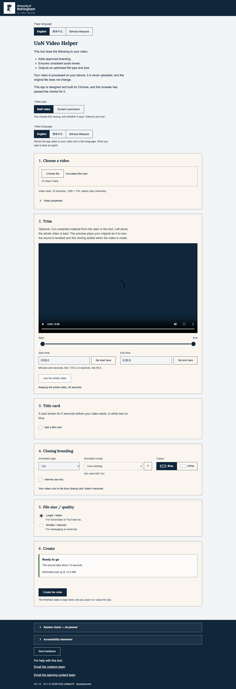
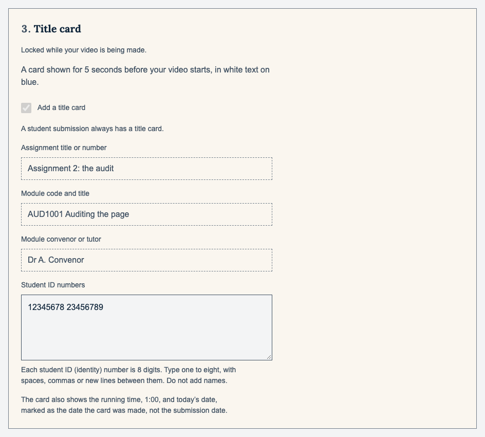

# UoN Video Helper — the page audited again, 20 October 2026

Backlog item VH-138. The three audits of 1 October run again on the live
page: VH-104's walk as a first-time member of staff, Choose to Save, at
desktop and phone width; the WCAG 2.2 check, this time against the page
rather than the documents; and VH-124's judgement of every state as a page.
The standard is theirs: [`UI-STANDARDS.md`](../../UI-STANDARDS.md), Carbon's
productive patterns, Nielsen's heuristics, WCAG 2.2 A to AAA, spec §7 to
§10 and §13, and the same three ranks.

**Verdict.** The page has kept most of what 1 October asked of it and has
carried the standard onto its new surfaces. Of the 25 UX findings, 20 hold
and two have regressed only in the Chinese table; of the 20 spec findings,
10 hold outright; of VH-124's 29 states, 16 hold as left. In the states the
walk reached, focus was handed on at every transition, the stages,
milestones, outcomes, losses and errors were written to live regions, no
target was under 44 px, no text run under 7:1, and nothing overflowed at
320 px or under text-spacing overrides, in three languages and three
themes. What falls short is new, and small in number: one file the page
trusts too much, a record that cannot tell the new cards apart, three live
switchers that say nothing about which job they change, a locked field that
looks live, a lifetime sentence that contradicts the line under it, a
previous video that loses its warnings, and a statement that contradicts
itself.

17 findings: 2 at rank 1, 13 at rank 2, 2 at rank 3.

| Baseline | |
| --- | --- |
| Commit | `d38ee79` on `origin/main`, 2026-10-20 — the owner's OneDrive checkout was level with it; no item was in flight |
| Walkthrough | Claude, in Chrome 155 driven headlessly over the DevTools protocol from a walker rebuilt in the session's scratchpad (kept in `evidence/measurements/walker/`); this worktree's dev server; the dev-only buttons hidden as production hides them |
| Source review | Codex astra (`gpt-6-astra`), read-only and blind from the same brief; kept as [codex-astra-audit-2026-10-20.md](codex-astra-audit-2026-10-20.md), its eight findings C-01 to C-08 each verified below |
| Then | Codex astra's adversarial critique of this bundle before commit, in three parts, kept as [codex-astra-critique-2026-10-20.md](codex-astra-critique-2026-10-20.md): what was applied and what was refused is in the decision log ("VH-138") |

## How it was done

- **Viewports.** Desktop at 1280 × 900. Phone at 390 × 844 with a mobile
  user agent (`navigator.userAgentData.mobile` true), touch and a coarse
  pointer. Reflow at 320 px. A 640 px viewport at a device scale of 2, which
  stands in for 200% zoom and is not the browser's own zoom. WCAG 1.4.12 text
  spacing injected. Light, dark and emulated forced colours. Each key state
  was captured in all of these.
- **Languages and switches.** The whole setup and a job in English, Simplified
  Chinese and Bahasa Malaysia; on each side of Staff video / Student
  submission; with a title card off and on; with every closing (Cut, Fade,
  Slide over a held frame, None, Internal use only) to a finished file.
- **As a person would.** Files chosen through the real file input
  (`DOM.setFileInputFiles`) and dropped as a real drag
  (`Input.dispatchDragEvent`); keys and touches as real events; the system's
  save dialog stood in for by a `showSaveFilePicker` stub writing into OPFS,
  and removed for the phone so the download route ran. One concession: the
  arrow keys did not move a closed `<select>` headless, so a closing was set
  by value with a change event, as a pointer would leave it; the selects'
  keyboard operation is therefore the user agent's word, not this walk's.
- **What was measured.** Every visible text run's contrast against its
  rendered background; every interactive target's size; every running-text
  block's longest line; horizontal overflow; the accessibility tree's names,
  roles, descriptions and states; every Tab stop's ring, geometry and
  obscuring; every live-region change with its time; the document title;
  the focused element at each transition; 54 focus rings on 18 controls in
  three themes. The digests are in [`evidence/measurements/`](evidence/measurements/),
  one per walk; a live-region change is a programmatic announcement, not
  what a screen reader says.
- **Material.** ffmpeg fixtures only: a 6-minute 1080p lecture stand-in and
  60 s and 30 s versions at 720p, a captioned file, a silent file, a 2 s
  file, a very quiet file, a 4:3 file, a ProRes master Chrome cannot decode,
  a text file named `.mp4`, and a 30 s file cut short at 70% of its bytes.
  Nothing from `samples/` was read, and no real recording's frame or name
  appears anywhere.
- **Two reviewers.** Codex astra read every surface from source while the
  walk ran. Each of its findings was reproduced live where the browser could
  reach it or re-read in source where it could not; each finding below says
  which, and the regression table says where its judgement was corrected.
  Its critique of the merged draft added two findings (V-11, V-12), raised
  four ranks, restored one, withdrew one finding to a question for the
  owner, and corrected the tables; the decision records each.
- **Evidence.** [`evidence/`](evidence/), named by finding (`v01-…`), by
  what was set aside (`aside-…`) and, for what held up, by state (`held-…`).

**Ranks.** **1** — a novice is blocked, misled, or could lose work or trust.
**2** — real friction, or a breach of a named standard. **3** — polish.

## Findings

### V-01 A file cut short is read, checked, encoded and recorded as whole — rank 1

**Saw.** A 30-second recording cut off at 70% of its bytes, as an
interrupted copy or a crashed recorder leaves one. Step 1: "Video read.
30 seconds, 1280 × 720, stereo (two channels)." Step 6: "Ready to go. This
should take about 10 seconds." No note. The job ran to "Your video is
ready." The record: "Made from truncated-30s.mp4: the whole video
(30 seconds), Larger / better, a cut to the blue closing card." The file
saved holds 34 s of picture (30 s plus the closing) and 20.9 s of sound:
the last nine seconds of the lecture are silent, over a held frame. ffmpeg
decodes 523 of the 750 frames the index promises and 20.8 s of the audio.

**Standard.** `project/rules.md` → Always: "Silent data loss is the worst
outcome: what cannot be carried through warns before processing starts";
the house digest's "fail loudly on data loss". Spec §9.2 (every error says
what happened). UI-STANDARDS → System status; Nielsen 1.

**Experience.** A lecturer publishes a recording whose sound stops before
the slides do, and nothing on the page told them the file was damaged. In
source: inspection reads the index without decoding; the analysis pass
consumes what decodes and flushes at the end of the data without checking
that the declared tail arrived; the encode keeps the declared spans for the
closing's timeline while the sound stops where the samples do; the output
check measures loudness and peak, not completeness. Neither existing
warning fires: decode damage looks for amplitude, extended silence for
measured silence, not absent samples. The fixture is malformed; the defect
is the pipeline's silence about it and the page's assurance.

**Direction.** Compare each track's decoded extent with the kept range,
on the analysis pass for the sound and at the encode's end for the picture
(the 3-second probe cannot certify the tail), allowing the legitimate
offsets and unequal lengths a sound and silent source have; say it before
Create where it is known then ("The file ends early: its sound stops at
20 s of 30."), and in the result where it is known only then; the record
gives the length made, never the length promised.

**Source.** `src/media/inspect.ts:180` (structure, no decode);
`src/media/audio-plan.ts:126`, `:158`, `:185` (gaps filled, flush at end);
`src/media/pipeline.ts:417`, `:759`, `:778`; `src/media/probe.ts:92`;
`src/media/output-verification.ts:39`; `src/audio/warnings.ts:79`, `:138`.
**From:** walkthrough; the fixture was made for the failed-job state and
found this instead; the sources from Codex astra's critique. **Evidence:**
`v01-cut-short-file-ready.png`, `v01-cut-short-file-record.png`; the saved
file's `ffprobe` in `README.md`.

### V-02 The record cannot tell the new cards apart — rank 1

**Saw.** A staff card and a submission card are both "a 5-second title
card" in the result and in the discard question; the video's language shows
only when the closing quotes "Internal use only". Two outputs of one
recording, one with a staff card and one with a submission's, or in two
video languages with a plain closing, read the same — and "Previous video"
appears only when the file changes, so for the same recording made twice the
second is "Finished video" and the first keeps its name.

**Standard.** Spec §9.1 (the one-line summary fixed when the job ends,
A-05's rule); UI-STANDARDS → Recognition over recall; Nielsen 6.

**Experience.** The rank-1 case A-05 named: the wrong version saved and
published by someone making several in a row. A first draft ranked this 2 on
the ground that U-03's label bounds the harm; the critique showed it does
not for the same recording, and the rank is restored.

**Direction.** The record carries the card's kind ("a 5-second staff title
card", "a 5-second submission card") and the language of the words the app
drew, whether or not it is the page's; never the card's words.

**Source.** `src/ui/result-summary.ts:39` (`titleCard: boolean`), `:114`
(`jobSummaryText`); `src/main.ts:2727` (the snapshot), `:3012` (the
"Previous video" condition). **From:** Codex C-01, verified in source and
seen live. **Evidence:** `v02-previous-video-record.png`,
`v02-submission-finished-zh.png`.

### V-03 The Student ID box does not read as locked — rank 2

**Saw.** During a submission's job every step says "Locked while your video
is being made." and the three text fields lose their fill and take a dashed
edge; the Student ID numbers box keeps its filled ground and its solid edge.
Computed during the job: the inputs `dashed 1px`, transparent; the textarea
`solid 1px`, `rgb(243, 244, 245)`. It is locked in fact — the fieldset is
disabled — and looks live.

**Standard.** UI-STANDARDS → Operable: "Disabled reads as disabled at a
glance: a field or segment loses its fill and takes a dashed edge."
Carbon's interaction states; Nielsen 4.

**Direction.** `.textarea:disabled` joins `.select:disabled,
.text-input:disabled` in `app.css`, in the forced-colours block too.

**Source.** `src/styles/app.css:991-992`, the textarea's own rule, the
forced-colours block; `src/main.ts:2256` (the lock). **From:** Codex C-04,
reproduced live. **Evidence:** `v03-submission-locked-textarea.png`.

### V-04 After a download, a re-drawn result forgets it was delivered — rank 2

**Saw.** On the phone, Save hands the file to the browser: the save line
says "Saving to your downloads folder — the browser may still be finishing
it … The video stays here until you start another one." and the result's own
line says "It stays here until you start another video or close this tab."
Press Create, then Keep it: the result is drawn again and its line is now
"It is kept here only until you save it or close this tab." — above a save
line still saying the opposite. In source the same re-draw follows choosing
another file and a withdrawn discard question.

**Standard.** UI-STANDARDS → System status, Consistency; spec §9.1 step 6
(the page says only what it knows).

**Direction.** The result remembers that it was delivered: `lifetimeOf`
starts from the kept result's delivered flag, not from `'unsaved'`, on every
path that draws it again.

**Source.** `src/main.ts:2997` (`let lifetimeOf … = 'unsaved'`), `:3091`;
the re-draws at `:1335`, `:2028` and Keep it. **From:** Codex astra's
regression row A-04, reproduced live on the phone. **Evidence:**
`v04-download-lifetime-before-keep.png`,
`v04-download-lifetime-after-keep.png`.

### V-05 The two video switches change the next job without saying so — rank 2

**Saw.** During an encode the Video type and Video language switches stay
live. Choosing English for the video language while a Chinese page's job
ran changed the step's line at once; the job kept its own; nothing on the
page said the change is for the next video, and nothing showed the running
job's own type and language.

**Standard.** UI-STANDARDS → System status, Recognition over recall;
Nielsen 1 and 6. Spec §9.1 says the switches are never locked, so locking
is not the fix. Page language is not in this finding: it changes the page
at once.

**Direction.** While a job runs or a result stands, one line under the two
switches: "Applies to the next video you make."; the running job's own type
and language with its progress, and in the record (V-02).

**Source.** `src/main.ts:604-646` (the switches' handlers); `:2727` (the
job's snapshot). **From:** Codex C-02, seen live. **Evidence:**
`v05-video-language-changed-during-job.png`.

### V-06 Step 3 states its rules only by refusing — rank 2

**Saw.** Under Student submission four fields show with no line that all
four are required and no `required` state; press Create and four errors
appear at once. Under Staff video nothing says what a card needs until the
refusal's sentence does.

**Standard.** WCAG 3.3.2 Labels or Instructions (A); UI-STANDARDS →
Content and form, Error prevention; Nielsen 5.

**Direction.** One line under the submission's box: "All four are needed."
with `aria-required` on the fields; under the staff box, a line saying any
of the four fields makes a card and that the date is filled for you. Keep
the per-field errors.

**Source.** `index.html` (the submission fields), `src/ui/title-card-step.ts`.
**From:** Codex C-03, seen live. **Evidence:**
`v06-submission-refused-four-errors.png`.

### V-07 A translated line sits inside the English diagnostics block — rank 2

**Saw (source).** When the email cannot carry every detail, the dialog's
`<pre lang="en-GB">` gains the page's own sentence ("Too long for the email,
so only in 'Copy message and details'") in Chinese or Malay, marked as
English. A long draft message brings it on without sending anything; the
walk's short message did not.

**Standard.** WCAG 3.1.2 Language of Parts (AA); spec §9.3.

**Direction.** The guidance line goes outside the English block, or in a
span with the page's `lang`: a change to the dialog's markup, not to a
translation.

**Source.** `src/ui/feedback.ts:242` (`feedbackDisclosure`);
`src/main.ts:3229`; `index.html` (`#feedback-details`). **From:** Codex
C-05, verified in source.

### V-08 Two Chinese save messages promise a viewing, and step 6 has two names — rank 2

**Saw.** On the Chinese page, step 6's heading is "6. 创造" and its button
"制作视频"; a stopped or cancelled save says "视频仍然在这里，您可以随时观看"
("the video is still here, you can watch it any time"), where the English
says "The video is still here when you want it." — and the page offers Save,
not a player. The Malay says it as the English does.

**Standard.** UI-STANDARDS → Consistency ("same words for the same
concepts"), user language; Nielsen 2 and 4; spec §9.2. A house rule, not
WCAG 3.2.4, which is about a set of pages.

**Direction.** One making word for the step and its button; the save
messages say the video is still here to save. Through the strings sheet,
for the campus colleague to confirm; no verdict on the rest of either
translation.

**Source.** `src/i18n/zh-Hans.ts:71`, `:311`, `:331`, `:332`. **From:** Codex
C-06, verified in source and on the Chinese page. **Evidence:**
`v08-step-6-two-names-zh.png`.

### V-09 The accessibility statement contradicts itself — rank 2

**Saw.** "Only automated checks have been run so far, so we cannot yet say
it fully meets them." Two paragraphs on: "We have also checked it by hand in
Chrome, at computer and phone widths." "Automated tests check … the reading
level of the words" — the reading-level gate measures the English table
only. The preview limitation names captions and flashing, not descriptions
or alternatives; the abbreviations limitation omits UoN. "We have not yet
chosen the next tests" lists checks §13 already requires.

**Standard.** Spec §9.3 and §13 (evidence or a recorded limitation);
UI-STANDARDS → Help and contextual guidance; Nielsen 10.

**Direction.** Say what was checked by whom and how far: the automated
gates and what each covers, the walks in Chrome (this one, with its views
and languages), and what waits on a person; separate the checks §13
requires from optional tools; tie "partially compliant" to the criteria
that are open (3.3.2, 3.1.2, 4.1.3 and the media ones). VH-137's review is
the place, and the known contradictions need not wait for its date.

**Source.** `src/i18n/en-GB.ts:812-834` and the two translations;
`test/readability.test.ts`. **From:** Codex C-07, seen live. **Evidence:**
`v09-statement-open.png`.

### V-10 Revealing Errors captured, and a preview that cannot play, are not announced — rank 2

**Saw.** A deliberate uncaught error revealed the Errors captured panel —
"Something in the tool went wrong. A video being made may not finish; your
original file is not affected…" — and no live region changed. In source, a
preview the player refuses shows "A preview is not available for this file.
You can still set the times." the same silent way, and locks the "Set …
here" buttons without handing focus on if one held it.

**Standard.** WCAG 4.1.3 Status Messages (AA); UI-STANDARDS → System status
("important status changes must be announced programmatically"); the
focus rule (VH-111).

**Direction.** Announce each through a live region that is on the page in
that state — the Create step's status line is hidden until a file is read,
so the file's line serves before then — with a short actionable sentence;
hand focus on from a control the preview's failure disables.

**Source.** `showError` in `src/main.ts:952`; the preview's `error` handler
and `applyControlLock` at `src/main.ts:1872`; `setStatus`'s own note at
`:756`; the status markup in `index.html`. **From:** Codex (4.1.3 row),
reproduced live for the panel; the focus point from its critique.
**Evidence:** `v10-errors-captured-unannounced.png`.

### V-11 The previous video loses its warnings — rank 2

**Saw (source).** A finished video's output warnings — a closing that fell
back, a track that could not be carried — are drawn beside the result but
are not part of the kept result; choosing another file, or any re-check,
withdraws them with the old verdict while the previous video and its Save
stay. The walk's previous-video state had no warning to lose.

**Standard.** UI-STANDARDS → Recognition over recall, System status;
`project/rules.md` → Always (nothing consequential dropped silently);
Nielsen 6.

**Direction.** The kept result carries its warnings and shows them with its
record, apart from the next file's pre-flight notes.

**Source.** `src/main.ts:1988` (`RetainedResult`), `:2811` (the warnings
drawn), `:874` and `:1310` (`withdrawVerdict` clears them). **From:** Codex
astra's critique, verified in source.

### V-12 When a save completes, Stop saving goes before focus is handed on — rank 2

**Saw (source).** Delivery hides Stop saving, then waits for the scratch
copy to be discarded, and only in the `finally` hands focus on from the
control that held it. A keyboard user resting on Stop saving loses their
place for the whole of that wait; the walk's instant saves did not show it.

**Standard.** UI-STANDARDS → Operable: "When a transition removes the
control that has focus, focus is handed to the control that continues the
task."

**Direction.** Hand focus on at delivery, before the clean-up, keeping the
clean-up as it is.

**Source.** `src/main.ts:3140`, `:3146`, `:3168`. **From:** Codex astra's
critique, verified in source.

### V-13 A storage block stays on screen through its re-check, and after a stopped one — rank 2

**Saw (source).** When a trim or preset change re-runs the check after a
storage block, step 1's refusal stays until the new verdict passes; while
the check runs, "Checking…" and the old block contradict each other, and a
stopped re-check leaves the block standing. Not reproducible here (the
worker's own storage estimate).

**Standard.** UI-STANDARDS → System status; VH-124's rule that a verdict no
longer describing the selection is withdrawn, visible and spoken.

**Direction.** Withdraw the block, and its spoken form, when the re-check
starts, as the verdict is; keep Check again.

**Source.** `withdrawVerdict` at `src/main.ts:874` (clears two containers,
not `sourceBlock`), `:1423`, `:1482`, `:1494-1500` (cleared only on a
pass), `:2138` (the stop leaves it). **From:** Codex (U-04, states 11, 12
and 28), verified in source.

### V-14 After Cancel or a failure, late reports still move the page — rank 2

**Saw (source).** Once Cancel is pressed the announcement is held, but a
stage report arriving in the settling window still moves the bar, the stage
line, the time left and the tab title; after a watchdog failure the
progress is hidden while the lock notes and the keep-awake notice go on
describing the video being made until the worker settles. Here the window
was 9 ms; on a slow machine it is the worker's settling time.

**Standard.** UI-STANDARDS → System status; VH-124's states 15 and 29.

**Direction.** Once a cancel or a failure is on screen, ignore progress
reports for the display, say that stopping is finishing, and keep the
safety locks; keep handling the terminal reply.

**Source.** `src/main.ts:1909`, `:1918-1930`; the failure path `:2850`,
`:2871`, `:1143`; the notices `:2219`, `:2258`. **From:** Codex (states 15
and 29), verified in source.

### V-15 Startup pending disables the chooser without a word — rank 2

**Saw (source).** While the load-time checks run the file input is disabled
and nothing beside it says to wait; the System check's summary says
"checking" at the foot of the page. The checks landed in 340 ms here, so
the state was not seen; a slow machine shows it longer.

**Standard.** UI-STANDARDS → System status ("every async action must show
status"), Empty and no-data states.

**Direction.** One short line in step 1's own status area until the checks
land.

**Source.** `src/main.ts:1203`; the summary in `index.html`. **From:** Codex
(state 30), verified in source.

### V-16 The decode-damage heading says done; its body says will — rank 3

**Saw (source).** "A damaged moment has been silenced" heads a note shown
before Create, whose body says the fraction of a second "will be silent
instead". The times listed are the original recording's, unsaid. Not
reproduced: no fixture produced a burst above +6 dBFS and no sample is used.

**Standard.** UI-STANDARDS → System status, Content and form; Nielsen 1.

**Direction.** "A damaged moment will be silenced" and "At 1:22 in your
recording".

**Source.** `src/i18n/en-GB.ts:578-586`; `src/ui/warning-text.ts:33`.
**From:** Codex C-08, verified in source.

### V-17 Errors captured names the footer's button, not its own — rank 3

**Saw.** The panel's sentence ends "Report it with the Send feedback button,
which adds these details." The button under it is "Report this problem";
"Send feedback" is in the footer, and does the same.

**Standard.** UI-STANDARDS → Consistency; Nielsen 4.

**Direction.** "Report it with Report this problem, which adds these
details."

**Source.** `failure.captured` in `src/i18n/en-GB.ts:702`, shown by
`src/main.ts:291`. **From:** walkthrough; the source corrected by the
critique. **Evidence:** `v17-errors-captured-two-names.png`.

## What held up

- Every 1 October remedy on the English page that the walk reached, as the
  regression table lists: the verdict withdrawn at the right moments, one
  primary button per state, focus handed on at the transitions walked, the
  stages and milestones written to the live region and nothing between
  them, the blocked file said beside Choose with a remedy that fits, the
  previous video named, the save on its own line.
- The new surfaces, measured: no target under 44 px, no text under 7:1, no
  horizontal scroll at 320 px, at the 640 px stand-in for 200% or under
  spacing overrides, in all three languages and both switch positions; a
  2 px ring on every control in light, dark and forced colours, 2 px outside
  the control on 16 of 18 and inset on the two slider thumbs; each switcher
  segment in its own `lang`; the switch written to its live region once; the
  page repainted in place with the file, the trim, the card's words, a
  running job and a result kept; a remembered language and side set at
  `DOMContentLoaded`, before the module's repaint, so no English frame
  was observed.
- The title card's refusals, when they fire: beside the box or the field,
  announced, with focus on the first field to fix; "This field is full, so
  the rest was not added." as typing passes the limit; unticking keeps the
  words.
- The submission card: locked on with its reason; four named errors at once
  when Create is pressed; the running-time line; the ID helper's plain
  words.
- Every closing's result line and record say what the file will carry and
  did: "marked 'Internal use only'", "sliding in over a held last frame",
  "no University closing".
- The time left: "About 50 seconds left" on its own line at 18%, written
  with the quarter, half and three-quarter milestones and not between them.
- The download route: "Saving to your downloads folder — the browser may
  still be finishing it …", the file in the downloads folder.
- The statement: seven headings, every link's purpose in its words, the
  advice service in a new tab and saying so; `#accessibility-statement` in
  the address opens it.
- Forced colours: the chosen segments, the slider's thumbs and fill, the
  primary button and the bar in `Highlight`; the logo on its band.

## Set aside, with reasons

- **A ticked card with nothing typed makes a card of today's date.** Tick
  "Add a title card", type nothing, press Create: the job runs and the
  record says "a 5-second title card"; the refusal "Fill in at least one of
  the four fields …" fires only once the date is cleared by hand
  (`aside-date-only-card-record.png`, `aside-card-refused-when-date-cleared.png`).
  A first draft called this a rank-2 defect; the critique showed spec §9.1
  step 3 fills the date and refuses only a card "with nothing on it", which
  a date is not, and `isCardEmpty` does exactly that. Whether a date-only
  card is wanted is the owner's question, as a wish line; V-06's advance
  instruction is the page's part.
- **The page's length.** The ready page is 3,722 px at desktop (2,765 on
  1 October; English, no card, the disclosures closed, the 6-minute fixture,
  900 px viewport), 4,128 with a card, 4,208 at 320 px; three switchers now
  sit above step 1. VH-104 set folding aside with reasons; the measurement
  is recorded for the owner's walk-through of VH-124 and for watching staff
  (VH-M4), not as a case for folding. VH-97 keeps its default.
- **The machine-translation notice above the title.** Its place is a design
  choice the owner made on 2026-10-18; its words and link are right.
- **The translated terms and reading level.** A person's, by the method's
  own limits; VH-105's wish lines cover them. The Chinese 40-glyph measure
  is measurable and was not reached by this walk's method (its Chinese
  paragraphs are short); it stays an evidence gap in the WCAG table.
- **The storage block, the failed job and the decode-damage note.** Not
  reproducible with the worker's own estimate or a fixture; read in source
  and marked so.
- **The native player's target sizes and controls.** The user agent's
  (WCAG 2.5.5's exemption, spec §9.3); its keyboard operation is not
  thereby exempt and is a person's check.
- **The three "Email …" routes to one address.** VH-137's, by decision.
- **The 2.2.2 question** on the moving stage, bar and time-left lines: a
  reading to record under §9.3 with an owner, not a defect seen; the WCAG
  table carries it.
- **The hidden toggletip's text in the walker's live log on a language
  change.** Hidden content is not in the accessibility tree; an artefact of
  the method, not an announcement. The two frames in which every other live
  region is quiet during a language switch are a race to listen for, not
  one observed.

## What only a person can judge

Carried from 1 October, with what has been done since and where each is
already recorded.

1. **A pilot session** — three to five staff with their own recordings,
   unaided (VH-M4). Add: whether Page language and Video language read as
   two different questions; whether staff and students find their side of
   the switch; whether the card's optional and required fields are
   understood before Create (V-06); whether a change during a job is
   understood as the next video's (V-05); whether a date-only card is ever
   wanted.
2. **Screen readers** — NVDA with Chrome, VoiceOver with Safari and Chrome.
   The live regions were logged here, not heard: what is spoken, suppressed,
   doubled or interrupted is theirs. The wish lines of VH-105, VH-127,
   VH-128, VH-122, VH-135 and VH-136 each name what to listen for; this
   audit adds V-10's two silent reveals, V-12's lost place, and the
   language switch's quiet frames.
3. **Real phones** — Chrome on Android, Safari 26 on iPhone (VH-113, still
   the owner's): the verdict, the download's destination, backgrounding, and
   now eight student IDs on a numeric keyboard with spaces or commas.
4. **Speech input** — Voice Control or Dragon: the two sets of three
   language names, the locked card controls, the submission fields. §13
   wants this completed or deferred in writing.
5. **Windows contrast themes** — U-11 and the new segments on a real theme
   rather than the emulation used here (VH-105's wish line).
6. **A managed University Windows laptop** — the save into a OneDrive
   folder, the email route, the screen awake through a long job.
7. **The browser's own zoom at 200%** — this walk used a 640 px viewport at
   a device scale of 2, which is not the same thing.
8. **The owner's WAVE check of 2026-10-18** — done, 10 of 10 reported,
   recorded in VH-130; keep the report so the statement can cite it (V-09).
9. **The owner's walk-through of VH-124 and VH-113** — still open; this
   bundle's captures are their evidence, not their sign-off.
10. **Listening and watching** — the Teams recording's limited sound
    (VH-106's wish line), the decode-damage boundaries (VH-122's), the title
    cards at full size (VH-127's, VH-128's), and now the cut-short file: what
    a viewer sees in the nine held seconds (V-01).

## Disposition

| Finding | Rank | Disposition |
| --- | --- | --- |
| V-01 | 1 | VH-139 |
| V-02, V-05, V-06 | 1, 2, 2 | VH-140 |
| V-03, V-04, V-07, V-10, V-11, V-12, V-13, V-14, V-15 | 2 | VH-141 |
| V-08, V-16, V-17 | 2, 3, 3 | VH-142 |
| V-09 | 2 | VH-137 (the owner's review, with a wish line) |
| The date-only card | — | a wish line for the owner |

Codex astra's eight, by number: C-01 → V-02, C-02 → V-05, C-03 → V-06,
C-04 → V-03, C-05 → V-07, C-06 → V-08, C-07 → V-09, C-08 → V-16; its
regression rows A-04, U-04, states 11, 15, 28, 30 and its 4.1.3 row → V-04,
V-13, V-14, V-15 and V-10; its critique → V-11 and V-12. Its "partly" on
U-07 is withdrawn by its own second reading (the encode is capped at 0.98
and the bar fills at ready).
