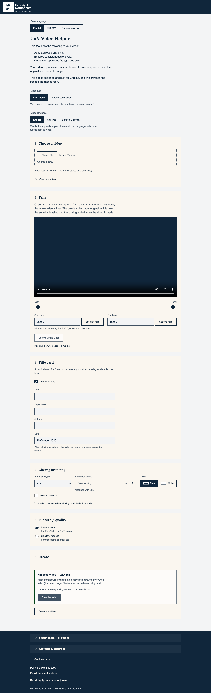

# UoN Video Helper — the page audited again, 20 October 2026

Backlog item VH-138. The three audits of 1 October run again on the live
page: VH-104's walk as a first-time member of staff, Choose to Save, at
desktop and phone width; the WCAG 2.2 check, this time against the page
rather than the documents; and VH-124's judgement of every state as a page.
The standard is theirs: [`UI-STANDARDS.md`](../../UI-STANDARDS.md), Carbon's
productive patterns, Nielsen's heuristics, WCAG 2.2 A to AAA, spec §7 to
§10 and §13, and the same three ranks.

**Verdict.** The page has kept almost everything 1 October asked of it and
has carried the standard onto its new surfaces. Of the 25 UX findings, 21
hold and two have regressed only in the Chinese table; of the 20 spec
findings, 11 hold outright and the rest are "partly" for want of a person's
check, not a broken rule; of VH-124's 29 states, 18 hold as left. Focus is
handed on at every transition, every announcement that mattered is made,
every target is 44 px, every ring is 2 px with 3:1, nothing overflows at
320 px, at 200% or under text-spacing overrides, in three languages and three
themes. What falls short is new, and small in number: one file the page
trusts too much, a title card that passes with nothing typed, three live
switchers that say nothing about which job they change, a record that cannot
tell the new cards apart, a locked field that looks live, a lifetime sentence
that contradicts the line under it, and a statement that contradicts itself.

16 findings: 1 at rank 1, 10 at rank 2, 5 at rank 3.

| Baseline | |
| --- | --- |
| Commit | `d38ee79` on `origin/main`, 2026-10-20 — the owner's OneDrive checkout was level with it; no item was in flight |
| Walkthrough | Claude, in Chrome 155 driven headlessly over the DevTools protocol from a walker rebuilt in the session's scratchpad; this worktree's dev server; the dev-only buttons hidden as production hides them |
| Source review | Codex astra (`gpt-6-astra`), read-only and blind from the same brief; kept as [codex-astra-audit-2026-10-20.md](codex-astra-audit-2026-10-20.md), its eight findings C-01 to C-08 each verified below |
| Then | Codex astra's adversarial critique of this bundle before commit, kept as [codex-astra-critique-2026-10-20.md](codex-astra-critique-2026-10-20.md); what it argued and what was applied are recorded there and in the decision |

## How it was done

- **Viewports.** Desktop at 1280 × 900. Phone at 390 × 844 with a mobile
  user agent (`navigator.userAgentData.mobile` true), touch and a coarse
  pointer. Reflow at 320 px. 200% zoom as 640 px at a device scale of 2.
  WCAG 1.4.12 text spacing injected. Light, dark and emulated forced
  colours. Each key state was captured in all of these.
- **Languages and switches.** The whole setup and a job in English, Simplified
  Chinese and Bahasa Malaysia; on each side of Staff video / Student
  submission; with a title card off and on; with every closing (Cut, Fade,
  Slide over a held frame, None, Internal use only) to a finished file.
- **As a person would.** Files chosen through the real file input
  (`DOM.setFileInputFiles`) and dropped as a real drag
  (`Input.dispatchDragEvent`); keys and touches as real events; the system's
  save dialog stood in for by a `showSaveFilePicker` stub writing into OPFS,
  and removed for the phone so the download route ran. One concession: the
  arrow keys did not move a closed `<select>` headless, so a closing was set
  by value with a change event, as a pointer would leave it.
- **What was measured.** Every visible text run's contrast against its
  rendered background; every interactive target's size; every running-text
  block's longest line; horizontal overflow; the accessibility tree's names,
  roles, descriptions and states; every Tab stop's ring, geometry and
  obscuring; every live-region change with its time; the document title;
  the focused element at each transition; 54 focus rings on 18 controls in
  three themes. The numbers are in the walker's JSON beside each capture;
  the ones a finding needs are quoted.
- **Material.** ffmpeg fixtures only: a 6-minute 1080p lecture stand-in and
  60 s and 30 s versions at 720p, a captioned file, a silent file, a 2 s
  file, a very quiet file, a 4:3 file, a ProRes master Chrome cannot decode,
  a text file named `.mp4`, and a 30 s file cut short at 70% of its bytes.
  Nothing from `samples/` was read, and no real recording's frame or name
  appears anywhere.
- **Two reviewers.** Codex astra read every surface from source while the
  walk ran. Each of its findings was reproduced live where the browser could
  reach it or re-read in source where it could not; each finding below says
  which, and the regression table says where its judgement was corrected.
- **Evidence.** [`evidence/`](evidence/), named by finding (`v01-…`) and, for
  what held up, by state (`held-…`).

**Ranks.** **1** — a novice is blocked, misled, or could lose work or trust.
**2** — real friction, or a breach of a named standard. **3** — polish.

## Findings

### V-01 A file cut short is read, checked, encoded and recorded as whole — rank 1

**Saw.** A 30-second recording cut off at 70% of its bytes, as an
interrupted copy or a crashed recorder leaves one. Step 1: "Video read.
30 seconds, 1280 × 720, stereo (two channels)." Step 6: "Ready to go. This
should take about 10 seconds." No note. The job ran to "Your video is
ready." The record: "Made from truncated-30s.mp4: the whole video
(30 seconds), Larger / better, a cut to the blue closing card." The file
saved holds 34 s of picture (30 s plus the closing) and 20.9 s of sound:
the last nine seconds of the lecture are silent, over a held frame. ffmpeg
decodes 523 of the 750 frames the index promises and 20.8 s of the audio.

**Standard.** `project/rules.md` → Always: "Silent data loss is the worst
outcome: what cannot be carried through warns before processing starts."
Spec §9.2 (every error says what happened); §13 criterion 2 (the output
content). UI-STANDARDS → System status; Nielsen 1.

**Experience.** A lecturer publishes a recording whose sound stops before
the slides do, and nothing on the page told them the file was damaged. The
verification that refuses an off-target loudness passes this file, because
the sound it measures is what was decoded.

**Direction.** Pre-flight compares what each track decodes with what the
index declares, on the probe and the analysis pass it already runs, and
says so before Create: "The file ends early: the sound stops at 20 s of 30."
A job whose decoded audio or video ends short of the kept range warns in the
result, and the record says the part kept as made, not as promised.

**Source.** `src/media/inspect.ts` (the declared duration); the analysis
pass in `src/workers/job.worker.ts`; `src/media/output-verification.ts`
(checks loudness, not length). **From:** walkthrough; the fixture was made
for the failed-job state and found this instead. **Evidence:**
`v01-cut-short-file-ready.png`, `v01-cut-short-file-record.png`; the saved
file's `ffprobe` in `README.md`.

### V-02 A ticked title card with nothing typed makes a card of today's date — rank 2

**Saw.** Tick "Add a title card": the Date field fills with "20 October
2026". Type nothing, press Create: the job runs and the record says "a
5-second title card". The refusal "Fill in at least one of the four
fields, or untick Add a title card." fires only once the date is cleared by
hand, which the walker had to do to see it.

**Standard.** UI-STANDARDS → Error prevention and recovery ("constrain
invalid input, validate early"; "prefer safe defaults"); Nielsen 5. Spec
§9.1 step 3: Create refuses "a ticked card with nothing on it" — the date
the page put there is not something the user put there.

**Experience.** Someone exploring the box, or ticking it meaning to come
back, gets five seconds of blue with a date on it at the front of their
lecture.

**Direction.** The pre-filled date does not count: a card needs a typed
Title, Department or Authors, or a date the user typed or changed; until
then Create refuses as the sentence already says. Or fill the date only once
another field has words.

**Source.** The emptiness check in `src/ui/title-card-step.ts` and
`refuseTitleCard` in `src/main.ts`; the fill on tick near `src/main.ts:2467`.
**From:** walkthrough. **Evidence:** `v02-date-only-card-record.png`,
`v02-card-refused-when-date-cleared.png`.

### V-03 The Student ID box does not read as locked — rank 2

**Saw.** During a submission's job every step says "Locked while your video
is being made." and the three text fields lose their fill and take a dashed
edge; the Student ID numbers box keeps its filled ground, its solid edge and
its resize handle. Computed during the job: the inputs `dashed 1px`,
transparent; the textarea `solid 1px`, `rgb(243, 244, 245)`.

**Standard.** UI-STANDARDS → Operable: "Disabled reads as disabled at a
glance: a field or segment loses its fill and takes a dashed edge."
Carbon's interaction states; Nielsen 4.

**Direction.** `.textarea:disabled` joins `.select:disabled,
.text-input:disabled` in `app.css`, and the forced-colours rule for them.

**Source.** `src/styles/app.css:991-992`, the forced-colours block.
**From:** Codex C-04, reproduced live. **Evidence:**
`v03-submission-locked-textarea.png`.

### V-04 After a download, Keep it reverts the result's lifetime sentence — rank 2

**Saw.** On the phone, Save hands the file to the browser: the save line
says "Saving to your downloads folder — the browser may still be finishing
it … The video stays here until you start another one." and the result's own
line says "It stays here until you start another video or close this tab."
Press Create, then Keep it: the result is drawn again and its line is now
"It is kept here only until you save it or close this tab." — above a save
line still saying the opposite.

**Standard.** UI-STANDARDS → System status, Consistency; spec §9.1 step 6
(the page says only what it knows). WCAG 3.2.4.

**Direction.** The result remembers that it was delivered: `lifetimeOf`
starts from the kept result's delivered flag, not from `'unsaved'`.

**Source.** `src/main.ts:2997` (`let lifetimeOf … = 'unsaved'`), `:3091`.
**From:** Codex astra's regression row A-04, reproduced live on the phone.
**Evidence:** `v04-download-lifetime-before-keep.png`,
`v04-download-lifetime-after-keep.png`.

### V-05 The record cannot tell the new cards apart — rank 2

**Saw.** A staff card and a submission card are both "a 5-second title
card" in the result and in the discard question; the video's language shows
only when the closing quotes "Internal use only". Two outputs of one
recording, one with a staff card and one with a submission's, or in two
video languages with a plain closing, read the same.

**Standard.** Spec §9.1 (the one-line summary fixed when the job ends);
UI-STANDARDS → Recognition over recall; Nielsen 6.

**Experience.** Bounded by U-03's fix — the previous video is named
"Previous video" — so the wrong one is less likely to be saved than on
1 October, which is why this is rank 2 where Codex astra argued 1.

**Direction.** The record carries the card's kind ("a 5-second staff title
card", "a 5-second submission card") and, when it differs from the page's,
the video language; never the card's words.

**Source.** `src/ui/result-summary.ts` (`JobRecord.titleCard: boolean`,
`jobSummaryText`); `src/main.ts:2727`. **From:** Codex C-01, verified in
source and seen live. **Evidence:** `v05-previous-video-record.png`,
`v05-submission-finished-zh.png`.

### V-06 The two video switches change the next job without saying so — rank 2

**Saw.** During an encode the Video type and Video language switches stay
live. Choosing English for the video language while a Chinese page's job
ran changed the step's line at once; the job kept its own; nothing on the
page said the change is for the next video.

**Standard.** UI-STANDARDS → System status, Recognition over recall;
Nielsen 1 and 6. Spec §9.1 says the switches are never locked, so locking
is not the fix.

**Direction.** While a job runs or a result stands, one line under the two
switches: "Applies to the next video you make." The record (V-05) then
says what this one was.

**Source.** `src/main.ts:604-646` (the switches' handlers). **From:** Codex
C-02, seen live. **Evidence:** `v06-video-language-changed-during-job.png`.

### V-07 Step 3 states its rules only by refusing — rank 2

**Saw.** Under Student submission four fields show with no line that all
four are required and no `required` state; press Create and four errors
appear at once. Under Staff video nothing says the fields are each optional
until the refusal's sentence does.

**Standard.** WCAG 3.3.2 Labels or Instructions (A); UI-STANDARDS →
Content and form, Error prevention; Nielsen 5.

**Direction.** One line under the submission's box: "All four are needed."
with `aria-required` on the fields; under the staff box, "Fill in any of the
four." Keep the per-field errors.

**Source.** `index.html` (the submission fields), `src/ui/title-card-step.ts`.
**From:** Codex C-03, seen live. **Evidence:**
`v07-submission-refused-four-errors.png`.

### V-08 A translated line sits inside the English diagnostics block — rank 2

**Saw (source).** When the email cannot carry every detail, the dialog's
`<pre lang="en-GB">` gains the page's own sentence ("Too long for the email,
so only in 'Copy message and details'") in Chinese or Malay, marked as
English. Not reproducible without an over-long email.

**Standard.** WCAG 3.1.2 Language of Parts (AA); spec §9.3.

**Direction.** The guidance line goes outside the English block, or in a
span with the page's `lang`.

**Source.** `src/ui/feedback.ts:242` (`feedbackDisclosure`);
`src/main.ts:3229`; `index.html` (`#feedback-details`). **From:** Codex
C-05, verified in source.

### V-09 Two Chinese save messages promise a viewing, and step 6 has two names — rank 2

**Saw.** On the Chinese page, step 6's heading is "6. 创造" and its button
"制作视频"; a stopped or cancelled save says "视频仍然在这里，您可以随时观看"
("the video is still here, you can watch it any time"), where the English
says "The video is still here when you want it." — and the page offers Save,
not a player. The Malay says it as the English does.

**Standard.** UI-STANDARDS → Consistency ("same words for the same
concepts"), user language; Nielsen 2 and 4; spec §9.2.

**Direction.** One making word for the step and its button; the save
messages say the video is still here to save. Through the strings sheet,
for the campus colleague to confirm.

**Source.** `src/i18n/zh-Hans.ts:71`, `:311`, `:331`, `:332`. **From:** Codex
C-06, verified in source and on the Chinese page. **Evidence:**
`v09-step-6-two-names-zh.png`.

### V-10 The accessibility statement contradicts itself — rank 2

**Saw.** "Only automated checks have been run so far, so we cannot yet say
it fully meets them." Two paragraphs on: "We have also checked it by hand in
Chrome, at computer and phone widths." "Automated tests check … the reading
level of the words" — the gate measures the English table only. "Colleagues
who speak each language are checking them on the live page" — none has
reported (VH-133). The preview limitation names captions and flashing, not
descriptions.

**Standard.** Spec §9.3 and §13 (evidence or a recorded limitation);
UI-STANDARDS → Help and contextual guidance; Nielsen 10.

**Direction.** Say what was checked by whom: the automated gates and what
they cover (English), the walks in Chrome (this one, with its views and
languages), and what waits on a person; tie "partially compliant" to the
criteria that are open (3.3.2, 3.1.2, 4.1.3 and the media ones) rather than
to the testing done. VH-137's review is the place.

**Source.** `src/i18n/en-GB.ts:812-826` and the two translations;
`test/readability.test.ts`. **From:** Codex C-07, seen live. **Evidence:**
`v10-statement-open.png`.

### V-11 Revealing Errors captured, and a preview that cannot play, are not announced — rank 2

**Saw.** A deliberate uncaught error revealed the Errors captured panel —
"Something in the tool went wrong. A video being made may not finish; your
original file is not affected…" — and no live region changed. In source, a
preview the player refuses shows "A preview is not available for this file.
You can still set the times." the same silent way.

**Standard.** WCAG 4.1.3 Status Messages (AA); UI-STANDARDS → System status
("important status changes must be announced programmatically").

**Direction.** The panel's first sentence is spoken through the status
line (`spokenOnly`) when the panel appears; the preview note likewise.

**Source.** `showError` in `src/main.ts:952`; the preview's `error`
handler at `src/main.ts:1872`. **From:** Codex (4.1.3 row), reproduced live
for the panel. **Evidence:** `v11-errors-captured-unannounced.png`.

### V-12 The decode-damage heading says done; its body says will — rank 3

**Saw (source).** "A damaged moment has been silenced" heads a note shown
before Create, whose body says the fraction of a second "will be silent
instead". The times listed are the original recording's, unsaid. Not
reproduced: no fixture produced a burst above +6 dBFS and no sample is used.

**Standard.** UI-STANDARDS → System status, Content and form; Nielsen 1.

**Direction.** "A damaged moment will be silenced" and "At 1:22 in your
recording".

**Source.** `src/i18n/en-GB.ts:578-586`; `src/ui/warning-text.ts:33`.
**From:** Codex C-08, verified in source.

### V-13 Errors captured names a button it does not show — rank 3

**Saw.** The panel's sentence ends "Report it with the Send feedback button,
which adds these details." The button under it is "Report this problem";
"Send feedback" is in the footer.

**Standard.** UI-STANDARDS → Consistency; Nielsen 4.

**Direction.** "Report it with the button below, which adds these details."

**Source.** `src/i18n/en-GB.ts` (`errors.intro`), `index.html`. **From:**
walkthrough. **Evidence:** `v13-errors-captured-two-names.png`.

### V-14 A storage block stays on screen through its re-check — rank 3

**Saw (source).** When a trim or preset change re-runs the check after a
storage block, step 1's refusal stays until the new verdict passes; while
the check runs, "Checking…" and the old block contradict each other. Not
reproducible here (the worker's own storage estimate).

**Standard.** UI-STANDARDS → System status; VH-124's rule that a verdict no
longer describing the selection is withdrawn.

**Direction.** Clear the block when the re-check starts, as the verdict is.

**Source.** `src/main.ts:1494-1500`. **From:** Codex (U-04, states 11 and
28), verified in source.

### V-15 Cancelling still lets late reports move the page — rank 3

**Saw (source).** Once Cancel is pressed the announcement is held
(`!cancelRequested`), but a stage report arriving in the window still moves
the bar, the stage line, the time left and the tab title. Here the window
was 9 ms; on a slow machine it is the worker's settling time.

**Standard.** UI-STANDARDS → System status; VH-124's state 15.

**Direction.** After Cancel, ignore progress reports for the display too;
keep handling the terminal reply.

**Source.** `src/main.ts:1918-1930`. **From:** Codex (state 15), verified in
source.

### V-16 Startup pending disables the chooser without a word — rank 3

**Saw (source).** While the load-time checks run the file input is disabled
and nothing beside it says to wait; the checks landed in 340 ms here, so the
state was not seen.

**Standard.** UI-STANDARDS → Empty and no-data states ("no blank panels or
silent failures"), System status.

**Direction.** A one-line "Checking this browser…" beside the chooser until
the checks land.

**Source.** `src/main.ts:1203`. **From:** Codex (state 30), verified in
source.

## What held up

- Every 1 October remedy on the English page, as the regression table
  lists: the verdict withdrawn at the right moments, one primary button per
  state, focus handed on at every transition, the stages and milestones
  announced and nothing between them, the blocked file said beside Choose
  with a remedy that fits, the previous video named, the save on its own
  line.
- The new surfaces, measured: no target under 44 px, no text under 7:1, no
  horizontal scroll at 320 px or 200% or under spacing overrides, in all
  three languages and both switch positions; a 2 px ring with 2 px of air on
  every control in light, dark and forced colours; each switcher segment in
  its own `lang`; the switch announced once; the page repainted in place
  with the file, the trim, the card's words, a running job and a result
  kept; a remembered language and side painted before the first frame, with
  no English flash.
- The title card's refusals, when they fire: beside the box or the field,
  announced, with focus on the first field to fix; "This field is full, so
  the rest was not added." as typing reaches the limit; unticking keeps the
  words.
- The submission card: locked on with its reason; four named errors at once
  when Create is pressed; the running-time line; the ID helper's plain
  words.
- Every closing's result line and record say what the file will carry and
  did: "marked 'Internal use only'", "sliding in over a held last frame",
  "no University closing".
- The time left: "About 50 seconds left" on its own line at 18%, spoken only
  with the quarter, half and three-quarter milestones.
- The download route: "Saving to your downloads folder — the browser may
  still be finishing it …", the file in the downloads folder.
- The statement: seven headings, every link's purpose in its words, the
  advice service in a new tab and saying so; `#accessibility-statement` in
  the address opens it.
- Forced colours: the chosen segments, the slider's thumbs and fill, the
  primary button and the bar in `Highlight`; the logo on its band.

## Set aside, with reasons

- **The page's length.** The ready page is 3,722 px at desktop (2,765 on
  1 October), 4,128 with a card, 4,208 at 320 px; three switchers now sit
  above step 1. VH-104 set folding aside with reasons that still hold, and
  this is the same audit, not a new design. The measurement is recorded for
  the owner's walk-through of VH-124; VH-97 keeps its default.
- **The machine-translation notice above the title.** Its place is a design
  choice the owner made on 2026-10-18; its words and link are right.
- **The Chinese 40-glyph measure, the translated terms and the reading
  level.** A person's, by the method's own limits; VH-105's wish lines
  cover them.
- **The storage block and the failed job.** Not reproducible with the
  worker's own estimate or a fixture; read in source and marked so.
- **The native player's Tab stops, target sizes and controls.** The user
  agent's (WCAG 2.5.5's exemption, spec §9.3).
- **The three "Email …" routes to one address.** VH-137's, by decision.
- **The 2.2.2 question** on the moving stage, bar and time-left lines: a
  reading to record under §9.3, not a defect seen.
- **The hidden toggletip's text in the walker's live log on a language
  change.** Hidden content is not in the accessibility tree; an artefact of
  the method, not an announcement.

## What only a person can judge

Carried from 1 October, with what has been done since and where each is
already recorded.

1. **A pilot session** — three to five staff with their own recordings,
   unaided (VH-M4). Add: whether Page language and Video language read as
   two different questions; whether staff and students find their side of
   the switch; whether the card's optional and required fields are
   understood before Create (V-07); whether a change during a job is
   understood as the next video's (V-06).
2. **Screen readers** — NVDA with Chrome, VoiceOver with Safari and Chrome.
   The announcements were logged here, not heard. The wish lines of VH-105,
   VH-127, VH-128, VH-122, VH-135 and VH-136 each name what to listen for;
   this audit adds V-11's two silent reveals.
3. **Real phones** — Chrome on Android, Safari 26 on iPhone (VH-113, still
   the owner's): the verdict, the download's destination, backgrounding, and
   now eight student IDs on a numeric keyboard with spaces or commas.
4. **Speech input** — Voice Control or Dragon: the two sets of three
   language names, the locked card controls, the submission fields.
5. **Windows contrast themes** — U-11 and the new segments on a real theme
   rather than the emulation used here (VH-105's wish line).
6. **A managed University Windows laptop** — the save into a OneDrive
   folder, the email route, the screen awake through a long job.
7. **The owner's WAVE check of 2026-10-18** — done, 10 of 10, recorded in
   VH-130; keep the report so the statement can cite it (V-10).
8. **The owner's walk-through of VH-124 and VH-113** — still open; this
   bundle's captures are their evidence, not their sign-off.
9. **Listening and watching** — the Teams recording's limited sound
   (VH-106's wish line), the decode-damage boundaries (VH-122's), the title
   cards at full size (VH-127's, VH-128's), and now the cut-short file: what
   a viewer sees in the nine held seconds (V-01).

## Disposition

| Finding | Rank | Disposition |
| --- | --- | --- |
| V-01 | 1 | VH-139 |
| V-02, V-05, V-06, V-07 | 2 | VH-140 |
| V-03, V-04, V-11, V-13, V-14, V-15, V-16 | 2, 3 | VH-141 |
| V-08, V-09 | 2 | VH-142 |
| V-10 | 2 | VH-137 (the owner's review, with a wish line) |
| V-12 | 3 | VH-142 |

Codex astra's eight, by number: C-01 → V-05, C-02 → V-06, C-03 → V-07,
C-04 → V-03, C-05 → V-08, C-06 → V-09, C-07 → V-10, C-08 → V-12; its
regression rows A-04, U-04, states 11, 15, 28 and 30 and its 4.1.3 row →
V-04, V-14, V-15, V-16 and V-11. Ranks changed from its report: C-01 down
to 2 (U-03's naming bounds the harm). Its "partly" on U-07 is withdrawn
(the encode is capped at 0.98 and the bar fills at ready).
